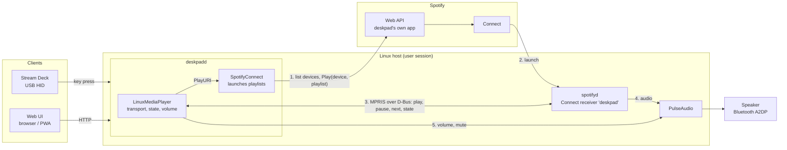
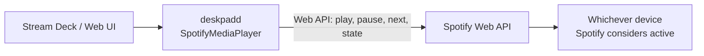

# deskpad

deskpad turns a button grid into a control surface for the media and devices around a desk. The primary client is a
15-button Elgato Stream Deck; a web UI that mirrors the same grid (with PWA support) is served by the same daemon.
Both are equal clients of one control model, and the daemon, `cmd/deskpadd`, wires them to optional integrations
(Spotify and Linux media control, weather, a Divoom Timebox, Bluetooth settings, house device control).

See [AGENTS.md](AGENTS.md) for the code layout, HTTP API and contributor guidance, and
[cmd/deskpadd/example_config.yaml](cmd/deskpadd/example_config.yaml) for a full configuration.

## How playback works

Spotify is involved in every playback setup. `playback.control` chooses how much of the control it does.

| `playback.control` | Spotify's role | Needs | Good for |
|---|---|---|---|
| `spotify` (default) | Controls everything through the Web API | Nothing local | macOS, or any machine that is not playing the audio itself |
| `local` | Only launches media; MPRIS and PulseAudio then control it | Linux, the D-Bus session bus, PulseAudio, and a player such as spotifyd | A headless Linux box wired to speakers |

### `local` control



1. **Launch.** Starting a playlist asks Spotify, with deskpad's own Spotify app, to play it on the named Connect
   device. This is the only call that has to go through Spotify: a Connect receiver such as spotifyd only exposes
   MPRIS once it is the active device, and a third-party player asked to open a playlist makes its own Web API calls
   on a shared, rate-limited client ID.
2. **Everything after is local.** Transport, state and volume use MPRIS and PulseAudio, so they are instant and use
   no API quota. A Spotify Connect launch that fails is returned as an error; it is not retried through MPRIS.
3. **Resilience.** Every MPRIS call has a 2s deadline, so a player that stops answering can't block a key press. The
   player is looked up on the bus when used, so it may start after deskpadd or restart under a new name.

If `playback.connect-device` is not set, the MPRIS player is asked to open the playlist itself (`OpenUri`).

### `spotify` control



### Configuration

```yaml
playback:
  control: local            # spotify | local
  connect-device: deskpad   # local only: Spotify Connect device playlists are launched on
  mpris-prefix: org.mpris.MediaPlayer2.spotifyd   # local only: only control players with this D-Bus name prefix
```

`connect-device` and `mpris-prefix` are ignored, with a warning in the log, under `control: spotify`. With `control: local`, deskpadd refuses
to start if the D-Bus session bus or PulseAudio isn't reachable, rather than quietly switching modes. The older
`use-mpris` key still works when `playback.control` is unset (`true` is `local`, `false` is `spotify`) and logs a
deprecation notice.

## Deploying deskpadd

Linux deployment files live in [deploy/](deploy/README.md): installing `deskpadd` as a systemd `--user` service on the
machine with the Stream Deck plugged in. It has to be built on that machine, because the Stream Deck's HID library
needs the target's `libudev` headers and doesn't cross-compile cleanly; `deploy/install.sh --build` does it in place.

## Setting up spotifyd

`local` control needs a Spotify Connect receiver on the machine. [deploy/spotifyd](deploy/spotifyd/README.md) has the
steps to build it as a `.deb`, install it with apt, log in, and run it as a user service.

## Remote Stream Deck

The Stream Deck does not have to be plugged into the machine running `deskpadd`. `cmd/deskpad-surface` runs on a
small host next to the Stream Deck (a Raspberry Pi, say), paints the daemon's keys over its HTTP API and sends key
presses back. The daemon and all its integrations stay where they are. See [deploy/surface](deploy/surface/README.md).

## Build and test

```sh
go build ./cmd/deskpadd
go test ./...
```

The D-Bus integration tests in `ui/controllers` run fake MPRIS players on a real session bus and skip themselves
when none is available.
